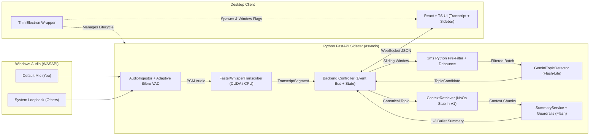

# Navi-Whisper — V1 System Architecture

## 1. Overview & Architectural Seams

`navi-whisper` passively listens to PC voice/video calls, transcribes both sides locally, detects specialized and technical concepts in context, and renders ultra-concise 1–3 bullet summaries in a companion sidebar.

To keep V1 fast to ship while preserving clean upgrade paths, the system is built around **four strict abstraction seams**:

| Seam | V1 Implementation | Future Swap Path | Isolation Boundary |
| :--- | :--- | :--- | :--- |
| **Desktop Shell** | Electron | Tauri v2 (or dual support) | `frontend/` has zero Electron imports; communicates strictly over localhost WebSocket + an optional `window.desktopBridge` interface |
| **Transcription** | Local `faster-whisper` (CUDA `float16` / CPU `int8` fallback) | `whisper.cpp` / Cloud STT | `Transcriber` Python `Protocol` accepting 16 kHz mono PCM buffers |
| **Topic Gatekeeper** | Python Pre-Filter + Gemini Flash-Lite | Local `GLiNER` / local small LLM | `TopicDetector` `Protocol` taking `(new_segments, context_window, excluded_ids)` |
| **Summary + RAG** | Gemini Flash + `NoOpRetriever` | Local Ollama/vLLM + Vector/Hybrid RAG | `LLMProvider` and `ContextRetriever` `Protocol` interfaces |

---

## 2. Component & Dataflow Diagram



---

## 3. End-to-End Runtime Sequence

```mermaid
sequenceDiagram
    participant A as Audio + Adaptive VAD
    participant W as faster-whisper (GPU)
    participant C as Backend Controller
    participant U as React UI (WebSocket)
    participant G as TopicDetector (Flash-Lite)
    participant S as SummaryService (Flash)

    A->>W: Utterance boundary / rolling pass (16kHz PCM, channel="others")
    W->>C: TranscriptFinal ("We moved session state from Redis to etcd.")
    C->>U: ws: transcript.final
    C->>C: Update 30s sliding context + run Python Pre-Filter
    Note over C: Passes filter & 1.5s debounce window
    C->>G: Extract topics (utterance + 30s window + seen_topics)
    G-->>C: [{id: "redis", ...}, {id: "etcd", ...}]
    C->>C: Dedup check ("redis" already seen -> skip; "etcd" is new)
    C->>U: ws: topic.detected (id="etcd", status="researching")
    C->>S: Summarize "etcd" (with conversation snippet + RAG stub)
    S-->>C: Structured 1-3 bullets
    C->>C: Enforce bullet & length guardrails
    C->>U: ws: topic.summary (id="etcd", bullets=[...])
```

---

## 4. Component Design

### 4.1 Audio Capture & Adaptive Transcription (`audio/` + `transcription/`)
* **WASAPI Dual Capture:** Uses `PyAudioWPatch` on Windows to open two independent non-blocking streams:
  1. **Default Microphone** → tagged `speaker: "you"`.
  2. **Default Render Device (Loopback)** → tagged `speaker: "others"` (captures Zoom, Teams, Meet, Discord over speakers or headphones without virtual audio cables).
* **Adaptive Two-Mechanism Segmentation (Deliberate & Rapid Speakers):**
  1. **Per-Channel Cadence-Aware VAD:** Each channel tracks a rolling EWMA of recent inter-word/inter-phrase silence durations (`320 ms` floor to `750 ms` ceiling) so fast talkers flush quicker on natural breath gaps without chopping slower speakers mid-thought.
  2. **Rolling Interim + Word-Timestamp Sentence Slicing (`LocalAgreement`):** When continuous speech exceeds ~`2.0 s` without a full silence break, Whisper runs every ~`1.0 s` (`word_timestamps=True`) to emit `transcript.partial`. Whenever a completed sentence boundary (`.`, `?`, `!`) stabilizes before trailing speech, the audio buffer slices cleanly at that word's end timestamp—immediately committing `transcript.final` for the finished sentence while keeping only the unfinished tail in the buffer.
* **Hallucination Guard:** Segments with elevated `no_speech_prob` or matching known Whisper silence hallucinations (`"Thank you for watching"`, `"Subtitles by..."`) are discarded prior to publication.

### 4.2 Backend Controller (`controller/`)
Acts as the **single mediator**—audio, topic detection, and LLM components never call each other directly.
* **Async Queues & Backpressure:**
  * `transcription_queue`: Bounded queue feeding the single GPU Whisper worker sequentially so dual-channel overlap never causes CUDA contention.
  * `topic_detection_queue`: Debounces rapid back-and-forth utterances over ~`1.5–2.0 s` before invoking the gatekeeper.
  * `summary_semaphore`: Caps concurrent Gemini summary requests (e.g., `asyncio.Semaphore(2)`).
* **In-Memory Session State & Configurable Persistence Seam:**
  * **Ephemeral by default (`persist_session: false`):** `SessionStore` holds the full session transcript, `TranscriptRingBuffer` (last ~30 seconds / ~10 utterances for LLM context), and `TopicRegistry` strictly in RAM—wiped cleanly on reset/exit.
  * **Configurable Disk Export:** Optional `SessionSink` interface (`MemoryOnlySink` by default; configurable `JsonlMarkdownSink` setting to persist transcripts + cards locally when enabled).
  * **Deduplication:** `TopicRegistry` maps normalized `canonical_id`s (and common aliases) so once a topic is summarized, it isn't re-fetched unless the user triggers **Refresh / Lookup** in the UI.

### 4.3 Domain-Adaptive Two-Stage Topic Detector (`topics/`)
1. **Stage 1 — Deterministic Python Pre-Filter (`< 1 ms`):**
   * Strips filler words (`"um"`, `"uh"`, `"like"`, `"you know"`).
   * Drops conversational backchannels and call logistics (`"yeah sounds good"`, `"can you see my screen"`, `"you're on mute"`).
   * Skips utterances with `< 4` meaningful tokens unless they contain an uppercase acronym, specialized term, or technical identifier.
2. **Stage 2 — Gemini Flash-Lite Gatekeeper (`~200–350 ms`, Broad Specialized Scope):**
   * Uses `google-genai` structured output (`response_schema`) with `temperature=0.0`.
   * **Cross-Domain Scope:** Detects specialized concepts, jargon, frameworks, methodologies, regulations, metrics, and acronyms across **any specialized domain** (software, finance, biotech/medicine, hardware, legal, product/analytics, science)—while still ignoring everyday English, attendee names, and small talk.
   * Receives:
     * `target_utterances`: Newly finalized text to inspect.
     * `conversation_context`: Previous ~25–30 seconds (used to infer the active domain—e.g., resolving *"LTV"* as *Customer Lifetime Value* in SaaS vs. *Loan-to-Value* in real estate—and repair phonetic STT typos).
     * `already_covered`: List of `canonical_id`s already in the sidebar.
   * Outputs `0..N` topics:
     ```json
     {
       "topics": [
         {
           "canonical_id": "saas-ltv",
           "display_name": "LTV (Customer Lifetime Value)",
           "category": "SaaS Metrics",
           "search_query": "Customer Lifetime Value LTV SaaS unit economics"
         }
       ]
     }
     ```

### 4.4 LLM Summary Service & Guardrails (`llm/` + `rag/`)
* **RAG Seam (`rag/retriever.py`):**
  * Controller calls `chunks = await retriever.retrieve(topic.search_query, context)` before building the summary prompt. In V1, `NoOpRetriever` returns `[]`.
* **Prompt & Generation Guardrails:**
  * **Model:** Gemini Flash (`temperature=0.15`, `max_output_tokens=160`).
  * **Structured Output Schema:** `{ "bullets": list[str] }` with `minItems=1, maxItems=3`.
  * **Prompt Rules:**
    * Bullet 1: Crisp plain-English definition of what the concept/term is in the detected domain.
    * Bullet 2: Core mechanism, formula, trade-off, or practical role.
    * Bullet 3 *(optional, only if warranted)*: Why it matters in the context of the current conversation snippet.
    * Max **18 words per bullet**; zero introductory or closing chatter.
  * **Deterministic Post-Guardrail:** Python validator trims leading bullet glyphs, enforces `1 <= len(bullets) <= 3`, and truncates runaway text cleanly.

### 4.5 Frontend UI & Thin Electron Shell (`frontend/` + `desktop/electron/`)
* **Shell Separation:**
  * `frontend/` is a standard **React + TypeScript + Vite** app connecting to `ws://127.0.0.1:8765/ws`.
  * `desktop/electron/` spawns the Python FastAPI process on startup (waiting for `/health`), opens the window, and exposes a minimal `preload.ts` bridge:
    * `desktopBridge.setAlwaysOnTop(enabled: boolean)`
    * `desktopBridge.setStealthMode(enabled: boolean)` — calls Electron's `win.setContentProtection(true)` to hide Navi from screen-sharing streams during calls.
* **UI Layout:**
  * **Main Column — Live Conversation:** Speaker-badged transcript (`You` vs. `Others`), muted italic `partial` caption snapping into `final` bubbles, auto-scroll with scroll-lock on hover, inline clickable badges on detected terms, and text-selection `"Summarize selection"` fallback.
  * **Right Sidebar — Navi Cards:** Reverse-chronological stack of topic cards (`Researching...` pulse state → 1–3 crisp bullets, domain category tag, Pin / Dismiss / Refresh actions).

---

## 5. WebSocket Protocol Contract (`ws://127.0.0.1:8765/ws`)

### Server → Client Events
| `type` | Payload Summary | UI Behavior |
| :--- | :--- | :--- |
| `system.status` | `{ listening, mic_device, loopback_device, gpu_active, persist_session }` | Updates header connection & audio indicators |
| `transcript.partial` | `{ segment_id, speaker, text, timestamp }` | Renders live rolling caption at bottom of speaker stream |
| `transcript.final` | `{ segment_id, speaker, text, timestamp }` | Commits finalized utterance bubble |
| `topic.detected` | `{ topic_id, display_name, category, source_segment_id }` | Highlights term in transcript + inserts skeleton card in sidebar |
| `topic.summary` | `{ topic_id, bullets: string[], latency_ms }` | Populates the 1–3 bullets on the skeleton card |
| `topic.error` | `{ topic_id, message }` | Shows subtle retry button on card |

### Client → Server Commands
| `type` | Payload Summary | Backend Action |
| :--- | :--- | :--- |
| `session.toggle` | `{ listening: boolean }` | Pauses/resumes WASAPI capture streams |
| `session.clear` | `{}` | Wipes in-memory transcript & topic state |
| `settings.update` | `{ persist_session?: boolean }` | Toggles disk persistence sink |
| `topic.manual_lookup` | `{ text: string, context_segment_id?: string }` | Bypasses gatekeeper and summarizes user-selected term |
| `topic.dismiss` | `{ topic_id: string, allow_redetect?: boolean }` | Removes card (keeps suppressed unless `allow_redetect` is true) |
| `devices.select` | `{ mic_id?: string, loopback_id?: string }` | Switches active Windows audio input/output devices |

---

## 6. Monorepo Layout

```text
navi-whisper/
├── docs/
│   └── ARCHITECTURE.md
├── backend/                        # Python 3.11+ (FastAPI + asyncio)
│   ├── app/
│   │   ├── main.py                 # FastAPI app, /health, /ws, lifespan startup
│   │   ├── config.py               # Env & runtime settings (GEMINI_API_KEY, Whisper, persistence)
│   │   ├── schemas/
│   │   │   └── events.py           # Pydantic models for internal & WS messages
│   │   ├── controller/
│   │   │   ├── orchestrator.py     # Central event bus, queues, concurrency control
│   │   │   ├── state.py            # SessionStore, TranscriptRingBuffer, TopicRegistry
│   │   │   └── sinks.py            # SessionSink Protocol (MemoryOnlySink + JsonlMarkdownSink)
│   │   ├── audio/
│   │   │   ├── wasapi_capture.py   # PyAudioWPatch dual-stream (Mic + Loopback)
│   │   │   └── adaptive_vad.py     # Per-channel cadence-aware Silero VAD + buffer slicer
│   │   ├── transcription/
│   │   │   ├── base.py             # Transcriber Protocol
│   │   │   └── whisper_local.py    # faster-whisper CUDA/CPU + LocalAgreement word slicing
│   │   ├── topics/
│   │   │   ├── prefilter.py        # Filler/backchannel filter + debounce logic
│   │   │   ├── base.py             # TopicDetector Protocol
│   │   │   └── gemini_detector.py  # Cross-domain Gemini Flash-Lite gatekeeper
│   │   ├── llm/
│   │   │   ├── base.py             # LLMProvider Protocol
│   │   │   ├── gemini_summary.py   # Gemini Flash summary engine
│   │   │   └── guardrails.py       # Deterministic bullet count/length validator
│   │   └── rag/
│   │       └── retriever.py        # ContextRetriever Protocol + NoOpRetriever
│   ├── tests/
│   └── pyproject.toml
├── frontend/                       # Pure React + TypeScript + Vite (Shell-agnostic)
│   ├── src/
│   │   ├── components/
│   │   ├── hooks/
│   │   └── types/
│   └── package.json
└── desktop/
    └── electron/                   # Thin Electron wrapper (Tauri can live alongside later)
        ├── src/
        │   ├── main.ts             # Spawns backend, manages BrowserWindow
        │   └── preload.ts          # Exposes window.desktopBridge
        └── package.json
```
